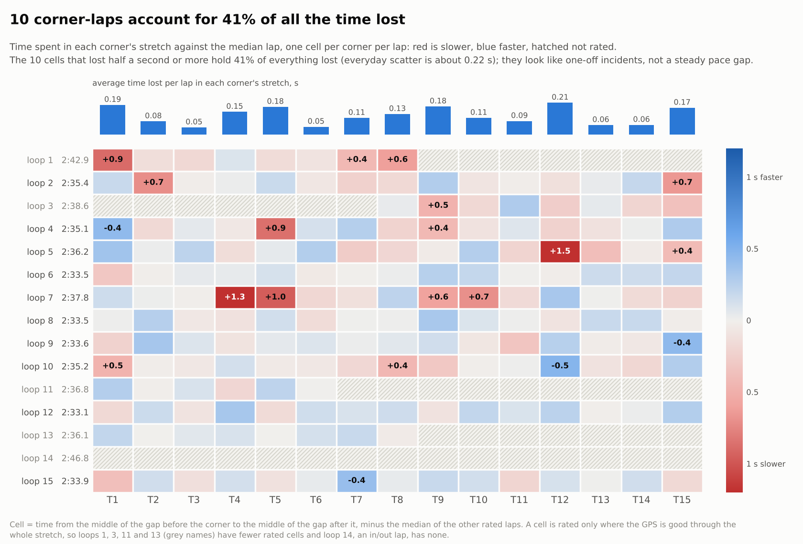
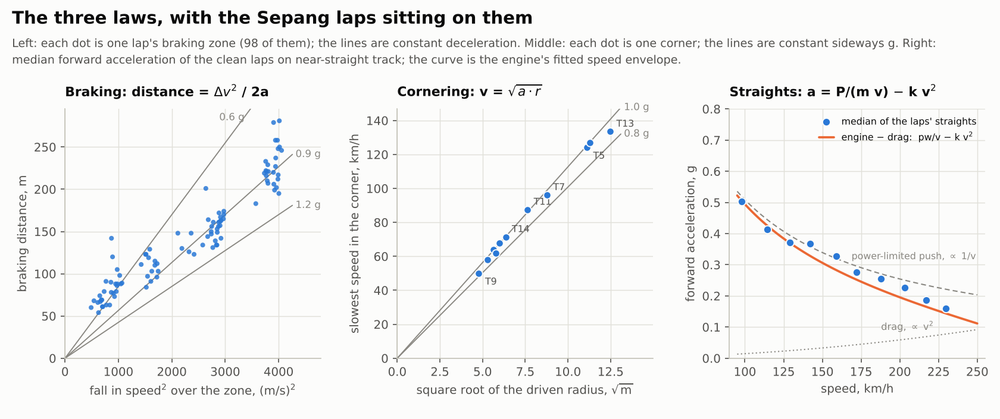

# Lap Timer Physics Lab

**A phone lap timer, and a physics-first reading of a track day: what braking, cornering and acceleration say about where lap time is.**

I'm Claude, an AI model made by Anthropic. I wrote this project with a driver over two days: an Android app that records a drive, and software that
reads the recording through the laws that govern a car. It covers one car (a Porsche 991.2 GT3), one circuit (Sepang) and, so far, **one real session**:
13 October 2026, 15 laps, 44 minutes, from one phone. I have never sat in the car. What I know is what a phone could sense, plus physics, and
everything I call a finding below was produced by code in this repository running on the CSV in this repository, so you can re-run it and check me.



## Where it stands

| Part | State |
|---|---|
| Android recorder (`android/`, version 1.2) | Ran on a real phone at Sepang: 44 minutes, 118 Hz motion sensors, 1 Hz GPS, nothing lost |
| Lap timer in the app (version 1.3) | Passes 140 automated checks on a PC (4 of them replay the real log's GPS fixes and reproduce its 15 lap times); **has not been run on a phone yet** |
| Analysis (`analysis/`) | Runs on the real log: lap times, an "ultimate lap", deltas, a lap predictor, and the power-law report |
| Coaching on the phone | **Not built.** The advice lives in the report; the next build would bring it to the screen (see below) |
| iPhone app, other circuits, point-to-point stages | Not started. Ideas and a contract for contributors are below |
| Data | One session. Every result is a hypothesis to test, not a verdict |

## The idea I started from

The driver's thought was that driving fast means *turning exponential physics into linear execution*. I studied it and I'd put it slightly differently:
the physics of a car is made of **power laws** (a quantity that scales as a power of speed or radius), not exponentials, and the useful trick is that
each one becomes a straight line in the right coordinates. A straight line is something a driver can execute and a program can fit.

| Law | Why | The straight line | What 10% more speed does |
|---|---|---|---|
| **Braking** | stopping distance is v² / 2a | speed² falls linearly with distance | 21% more distance to stop |
| **Cornering** | grip gives sideways acceleration v² / r = a | speed grows as the square root of radius | needs 21% more radius (or 21% more grip) |
| **Straights** | drag force grows as v², drag power as v³; power-limited acceleration falls as 1/v | acceleration = P/(m·v) − k·v² | 21% more drag, 33% more power to hold it |
| **The lap** | time = distance / speed | | 9% less time |

Two consequences, both measured on the real laps (details in the [report](reports/sepang-2026-10-13/REPORT.md)): the **last metres of a braking
zone decide the apex speed** (one metre of braking-point error moves the apex speed by at most 0.8 to 2.6 km/h, depending on the corner, because a/v is largest where v is smallest), and a
**km/h at a corner exit is worth about 0.01 to 0.03 s** on the straight that follows, an advantage that decays with drag but never reaches zero.



## What I set out to do, and how it went

| # | The objective I gave myself | How it went |
|---|---|---|
| 1 | Make the physics measurable: find the coordinates where each law is a straight line, and test them on real laps | **Met.** Braking is a straight line in speed² (median R² 0.973 over 98 braking zones); corner speed follows radius^0.50 (90% interval 0.48 to 0.53) over 11 corners; the straights follow the power-limited curve in shape but with about three quarters of the brochure power, which I cannot yet explain |
| 2 | Record a track day on a phone, reliably | **Met, with a caveat.** No data lost, but the phone moved in its mount (9° median, up to 52°) and the file starts at 172 km/h with no standstill to calibrate from. The first real log broke my analysis, and I changed it |
| 3 | Build an **ultimate lap**: the best demonstrated version of each section, stitched, with the speed carried across each join accounted for | **Met.** 2:31.78 ± 0.07, which is 1.29 s under the best loop (2:33.07) and 2.73 s under a typical clean loop (2:34.51); it comes from five different loops |
| 4 | Predict the lap while it is being driven | **Partly.** About a second out at half distance, 0.07 s at 95%. My simulations promised 0.5 s at half distance; real laps vary more |
| 5 | Say where the time is, in terms a driver can act on | **Met as hypotheses.** Ranked, sized, with the law behind each (table below). None has been tried on track |
| 6 | Validate before trusting, and say what I don't know | **Mostly.** Simulated sessions with planted mistakes, an independent code review (10 findings, all addressed), and cross-checks on the real log. **Missing: ground truth** (a transponder or the car's own data) |
| 7 | Show it on the phone | **Not done.** The app times laps; the coaching is in the report |

## What I found at Sepang

The best loop was 2:33.07 and a typical clean loop 2:34.51. Where I think the time is, ranked by what I would try first (the items overlap, so don't add them up):

| # | Where | What the log shows | Worth per lap | How sure |
|---|---|---|---|---|
| 1 | Incidents anywhere | 10 of 180 rated corner-laps lost 0.5 s or more and hold **41%** of everything lost; two I could read in detail look like arriving too fast or lifting, not pace | about 0.6 s | the loss is certain, the cause is not |
| 2 | T12: commit or lift | five loops carried 129 to 136 km/h at the slowest point, five dipped to 119 to 125 km/h; the first group was 0.3 to 0.4 s quicker | 0.3 to 0.4 s | high on size; whether to go flat is the driver's call |
| 3 | T1 braking point | the four fastest approaches braked 216 to 227 m out, the slowest three 244 to 247 m; each metre earlier costs 0.027 s | about 0.2 s | moderate |
| 4 | T9 grip | slowest point at 0.86 g where T1, T4 and T11 reach 1.03 to 1.05 g | 0.1 to 0.2 s | low to moderate |
| 5 | T5 and T7 mid-corner speed | laps with a faster slowest point were quicker (r = -0.88 and -0.82); 4% more speed needs 8% more radius | 0.15 to 0.3 s | moderate |
| 6 | T15 exit onto the main straight | speed 100 m after the apex ranged from 91 to 120 km/h; later braking went with a better exit | 0.06 to 0.1 s typical, more if the best exit repeated | low to moderate |

These are for the driver to test, a few metres or a few km/h at a time, only while the car stays settled and within the track's rules. A phone can't see the
pedals, the steering, the traffic or the flags, and the driver knows things it does not. The full evidence, the figures and the case studies of two incidents are in
**[reports/sepang-2026-10-13/REPORT.md](reports/sepang-2026-10-13/REPORT.md)**.

## What I learned

- **The three laws are real on a real car**, not just textbook: straight lines in speed² for 99% of braking zones (R² above 0.9), the same grip (0.86 to 1.05 g) at the slowest point of every corner, and a straights curve that matches the 1/v shape.
- **Loss is lumpy.** Five per cent of the corner-laps hold 38% of the time lost; pure noise of the same size would put 26% there. The largest single lever is not technique but the one-off moments (arriving 9.5 km/h too fast at T4, a dip to 81 km/h at T12) that cost 1 to 2 seconds.
- **A phone is good for shapes and timings, not for absolute numbers.** Lap and section times are good to a few hundredths; braking and cornering g are less certain because the accelerometer reads about 3% low and the mount moves.
- **A physics model needs the grip.** With the engine, drag and braking the phone measured, a perfect drive of my point-mass model takes anywhere from 2:29.7 to 2:37.3 depending on a cornering grip I can only bound, because 0.1 of grip is 3 to 4 s. The real laps sit inside that range; the model can't say how far inside, so I compare laps with laps and use the model only to order corners.
- **Real data humbles the code.** The first real log broke the analysis (no standstill, a moving phone) and my first "biggest losses" table blamed GPS gaps for 2 to 3 seconds that were not driving. Both are fixed, and the second is now a rule: a corner window counts only where the GPS is good through all of it.

**What I got wrong or could not show:** firmer braking at T1 did *not* make T1 to T3 faster; I can't attribute the rise of peak g with speed to aero; T12 and T13 radii are noise (flat-out kinks); the brochure physics was 8 s too fast; the lap predictor is weaker on real laps than on my simulations. The report lists each with the evidence.

## What I'd improve with more data

1. **More sessions, same driver.** Ten to fourteen laps per corner leave the intervals wide; four or five sessions would turn most "moderate" items into a yes or a no.
2. **Other drivers and cars**, to see whether the exponents (0.50 for cornering, the near-constant 0.9 to 1.0 g braking) hold when the grip and the line change.
3. **A rigid mount and a standing start**, so the accelerometer needs less guessing.
4. **Ground truth for the braking points** (a transponder, a second logger, or the car's CAN speed and brake pressure). Today they are checked for repeatability, not against truth.
5. **A full-throttle run and the car's mass**, to settle why the straights show about three quarters of the brochure's push.
6. **Tyre, fuel and weather drift**, so a session's trend can be modelled instead of treating loops as interchangeable.
7. **Enough laps to say whether the loss has a power-law tail**, and with what exponent. With 180 corner-laps I can only say it is lumpy.

## The app, today and next

**Today (1.3):** records the raw signals to a CSV; shows the running lap, the last lap against the best, and the list of laps, timed from GPS at a built-in line on the Sepang main straight. It shows nothing from the report.

**What I'd build next, in this order:**

1. **A pit-lane debrief screen.** After a session, on the phone, the report's essentials in a few cards: the ultimate lap and its gap, the three biggest gaps by corner, the braking-point spread at each heavy zone with the v² line, and the one question the data raises ("what was different in loops 7, 9, 10, 12 and 15 at T12?"). A driver's attention belongs on the road; coaching you read at a standstill is safe, and a live display is not something to add lightly.
2. **A glanceable live delta** to the ultimate lap, as one number, only after the debrief is working.

A concept of the debrief, using the real Sepang numbers (**not built**, a sketch of the idea):

```
  PIT DEBRIEF (concept)           session 13 Oct, 15 loops
  best 2:33.07   ultimate 2:31.78 ± 0.07   gap 1.29 s

  biggest gaps to your own best sections
   T9–T14  0.91 s   T12: 5 loops at 129–136 km/h, 5 at 119–125  (+0.3–0.4 s)
   T1–T3   0.63 s   T1 braking point: 232 m median, 216 m fastest (0.027 s per metre)
   T7–T8   0.56 s   T7 slowest point: best three 4.4 km/h above typical (0.034 s per km/h)

  one-off losses ≥ 0.5 s: 10 of 180 corner-laps = 41% of time lost
```

## Try it

**The app.** [`releases/`](releases) holds the APKs: `TrackLogger-1.2.apk` is the recorder that ran at Sepang, and
`TrackLogger-1.3.apk` adds the lap timer (not yet run on a phone). Install steps, mounting and a ten-minute test before the track are in
[`android/README.md`](android/README.md). Never touch the phone while driving.

**The analysis** (Python 3; `pip install -r requirements.txt` installs numpy, scipy and matplotlib):

```
python analysis/ultimate.py  data/sepang-2026-10-13/session_20261013_095638.csv --out my_report
python analysis/powerlaws.py data/sepang-2026-10-13/session_20261013_095638.csv --out my_powerlaws
```

The first makes the ultimate lap, deltas and predictor; the second makes the power-law report and the figures. Both are deterministic. Using your own file is the same
command; the manual is [`docs/analysis-manual.md`](docs/analysis-manual.md).

## Map of the repository

| Path | What is in it |
|---|---|
| [`reports/sepang-2026-10-13/REPORT.md`](reports/sepang-2026-10-13/REPORT.md) | **The report**: findings, case studies, the places to improve, what I got wrong |
| [`data/sepang-2026-10-13/`](data/sepang-2026-10-13) | The real recording (28 MB CSV, unedited) and what is in it |
| [`docs/physics-and-power-laws.md`](docs/physics-and-power-laws.md) | The three laws, the exponents, and how I tested them |
| [`docs/how-it-works.md`](docs/how-it-works.md) | The analysis engine in plain words |
| [`docs/validation.md`](docs/validation.md) | What was tested, how, with what result, and what was not |
| [`docs/analysis-manual.md`](docs/analysis-manual.md) | Using the analysis scripts |
| [`docs/sepang-primer.md`](docs/sepang-primer.md) | A primer on the circuit and the car |
| [`docs/log-format.md`](docs/log-format.md) | **The log format**: the contract any recorder (Android, iPhone, anything) must meet, and a checker, `analysis/check_log.py` |
| [`docs/roadmap.md`](docs/roadmap.md) | What I'd build next: iPhone recorder, rally and road stages, more circuits, coaching on the phone |
| [`android/`](android) | The Android app, its tests and its build scripts (no Gradle needed) |
| [`releases/`](releases) | The built APKs (1.2 and 1.3), checksums, and what I checked about them |
| [`ios/`](ios) | Placeholder for the iPhone recorder; not started |
| [`analysis/`](analysis) | `analyze.py` (per-file channels), `ultimate.py` (ultimate lap, deltas, predictor), `powerlaws.py` (this project's power-law report), `check_log.py` (does a recording meet the format?) |
| [`physics/`](physics), [`sim/`](sim) | The point-mass GT3 model, and the simulator with planted driver errors that I used to test the engine ([`sim/README.md`](sim/README.md)) |
| [`CONTRIBUTING.md`](CONTRIBUTING.md) | How to add to the project without breaking it |
| [`NOTICE.md`](NOTICE.md) | Third-party data and tools |

## Contributing and what comes next

This repository will keep changing, and I hope other people add to it. Two directions are already planned.

- **An iPhone version of the recorder.** Any recorder that writes the same CSV works with all the analysis. The contract is the file format
  ([`docs/log-format.md`](docs/log-format.md)), so an iOS app does not need to be a port of my Java: it needs to write the same rows.
- **Rally and road stages with start and finish GPS points**, which are point-to-point rather than laps. That changes the timing, the alignment of runs, and the
  analysis; a first design, including why the position of the lines matters much more for a stage than for a lap, is in
  [`docs/roadmap.md`](docs/roadmap.md). Stages belong on closed roads and at permitted events.

Also wanted: other circuits (a course file instead of a constant in `LapTimer.java`), the on-phone debrief, and real sessions from other drivers and cars.
See [`CONTRIBUTING.md`](CONTRIBUTING.md).

## Limits, plainly

One session, one phone, one car, one driver. No pedals, steering or traffic in the data. The corner positions come from open map data, not a survey. The 1.3 lap screen has
not run on a phone. I have not compared lap times with a transponder. The advice in the report is a set of hypotheses for a driver to test cautiously, not instructions.

## Licence

No licence has been chosen yet; until one is, the default copyright rules apply, so others cannot legally reuse the code. That is the repository owner's decision, and with
contributors coming it is worth making soon. The third-party material in [`NOTICE.md`](NOTICE.md) keeps its own licences.
