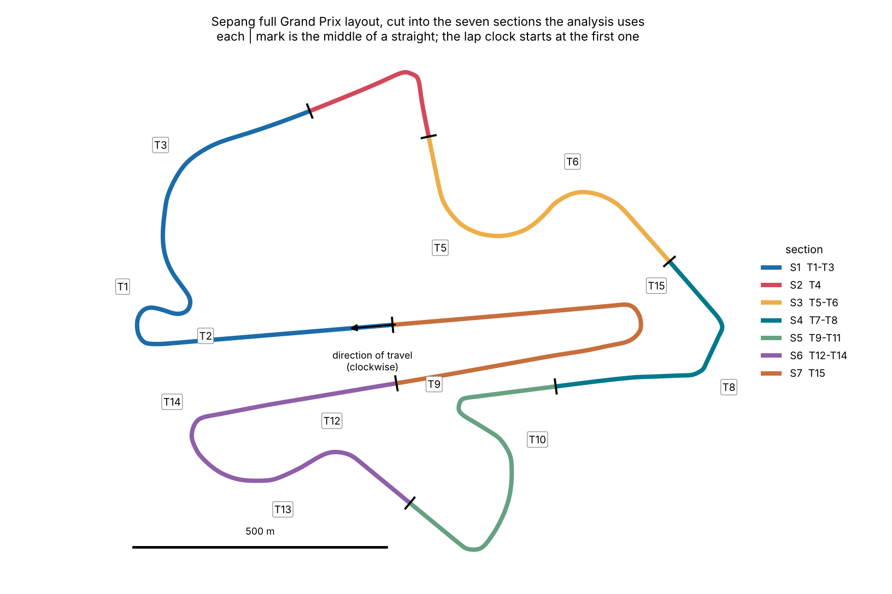

# Sepang GT3 primer

*Offline copy of the document of the same name, 13 Oct 2026. I wrote it before the first real log arrived, from the circuit geometry and published sources. On the real log the engine cut the loop into **five** sections (T1-T3, T4-T6, T7-T8, T9-T14, T15), not the seven below, because it cuts only where it finds a long straight in the driver's own laps; the corner-by-corner notes and the source list are unchanged. What the real laps showed is in [`../reports/sepang-2026-10-13/REPORT.md`](../reports/sepang-2026-10-13/REPORT.md).*

Sepang is a clockwise 5.543 km lap of 15 turns. The analysis tool cuts it into seven sections at the middle of each straight, and **speed carried out of T14, T15 and T4 is worth the most**.

## The lap in seven sections

A section runs from the middle of one straight to the middle of the next, so each holds whole corners plus the straights either side. The lap clock starts mid-way along the main straight because the start/finish line's coordinates could not be verified; your loops will not line up with the dash's timing-line laps.

The weight column is the physics model's value of speed: the lap time that 1 km/h of extra speed is worth when you cross the start of that section. Speed carried out of T15, T14 and T4 is worth roughly three to five times as much as speed out of T3 or T6.

| Section | Turns | Length (m) | Speed that counts at its start | Weight (s per +1 km/h) | What decides it |
|---|---|---|---|---|---|
| S1 | T1-T3 | 1240 | Out of T15, along the main straight (885 m) | 0.015 | Late braking into T1, the biggest braking zone; a clean T2 hairpin exit; speed carried through T3 |
| S2 | T4 | 350 | Out of T3 | 0.004 | Braking into T4, then a strong exit onto the short straight to T5 |
| S3 | T5-T6 | 689 | Out of T4 | 0.014 | Smooth steering and pedals through the fast left-right; a patient T6 exit |
| S4 | T7-T8 | 555 | Out of T6 | 0.003 | Late braking to the first apex of the double-apex right, then the T8 exit |
| S5 | T9-T11 | 722 | Out of T8 | 0.009 | T9 hairpin braking and traction, the T10 acceleration zone, then braking while turning into T11 |
| S6 | T12-T14 | 954 | Out of T11 | 0.010 | A smooth T12-T13, then T14: its exit sets the speed along the back straight |
| S7 | T15 | 1027 | Out of T14, along the back straight (740 m) | 0.015 | T15 braking and the exit onto the main straight |

The weights and straight lengths come from the circuit geometry and the simulated test sessions; your own report re-measures the weights from your laps.

## Corner by corner

Notes cite their source by short name, listed with links at the end: Driver61 (D61), Coulthard (COU), Barrichello (BAR), Honda (HON), Wikipedia (WIKI), Eurosport (EUR). No GT-car gears or minimum speeds were found anywhere, so the F1 and Moto3 figures in those sources are not GT3 figures. The speed column is the physics model at 1.2 g of grip on a smooth line. It has not been checked against any real lap, and in my simulated tests such a model ran 5 to 30 % above the simulated driver. Use it to order the corners, not as a target.

| Turn | Dir | Character | Model speed, entry to slowest (km/h) | What the sources add |
|---|---|---|---|---|
| T1 | R | Long, slow right; the hardest braking zone | 246 to 62 | The main overtaking spot (HON, COU). Late braking saves time; work well to the right to set up T2 (D61). Approach bumps were removed in 2016 (EUR). The geometry tightens twice, so expect two speed minima. |
| T2 | L | Tight hairpin, downhill, blind turn-in | 99 to 53 | The ground falls away before the apex, so be patient and get a good exit (D61). The inside was raised in 2016 so the apex kerb is easier to see (EUR). |
| T3 | R | Long, fast right | speed rises through it | F1 cars were flat (COU, BAR). Driver61 calls it an acceleration zone that is harder in powerful GT cars; look for the exit kerb. Probably the low point of the 22 m elevation range (inference). |
| T4 | R | Langkawi Curve, about 90 degrees | 217 to 73 | Heavy braking with easy references and a big apex kerb; the grass beyond it is risky (D61). The track rises through the apex and can induce oversteer (COU). A strong exit feeds the fast section after it (HON). |
| T5 | L | Genting Curve, fast left | 172 to 128 | Off-camber, gentle turn-in, late apex, easy to spin: be smooth on steering and pedals (D61). Lift mid-corner and keep left to set up T6 (COU). Banking reprofiled in 2016 (EUR). |
| T6 | R | Second half of the Genting S | 155 to 113 | The entry is a compromise and the exit is simple (D61); then full power onto the straight to T7 (COU). |
| T7 | R | First apex of the KLIA curve, a double-apex right | 193 to 86 | Late braking to the first apex; the kerbs can unsettle the car (D61). F1 drivers took T7-T8 as one corner (COU). |
| T8 | R | Second apex | 124 to 96 | Use only the inner half of the exit kerb because the outer half slopes away (D61). |
| T9 | L | Berjaya Tioman Corner, the slowest hairpin, uphill | 201 to 58 | Many braking markers. A crest at the apex makes most cars oversteer, so be patient on the throttle (D61, COU). Traction on the exit is the key (BAR). |
| T10 | R | Curved, uphill acceleration zone | 125 to 118, barely a minimum | Vision and precise positioning are key (D61). It runs straight into T11. |
| T11 | R | Medium-speed right | 159 to 82 | Braking while turning: build brake pressure gently to avoid oversteer; the exit is simple once at the apex (D61). Tricky entry, easy to overshoot (COU). Probably the high point of the elevation range (inference). |
| T12 | L | Fast left, starting downhill | 178 to 115 | F1 cars were flat on entry (COU, BAR). Needs confidence and vision; be smooth and bleed off inputs (D61). |
| T13 | R | Fast right as the road drops | no distinct minimum | The drop induces understeer on entry (COU). The model treats T13 and T14 as one long braking-while-turning sequence. |
| T14 | R | Sunway Lagoon curve, technical and blind | 121 to 75 | Braking while turning; drivers often take two or three stabs at turn-in (COU). The exit is critical because it leads onto a very long straight (D61, HON). |
| T15 | L | Final hairpin at the end of the back straight | 240 to 70 | Hard braking with many references; you can V the corner for a better exit (D61). Wide entry, use the exit kerb (COU). The inside was raised about 1 m in 2016 and the camber is reversed, so grip comes mainly from the tyres (EUR, WIKI). |

## What the physics model says

The model is a point-mass lap simulation of the 991.2 GT3 (assumed 1,580 kg with driver and fuel, 368 kW, drag area 0.66 m2) on a perfect, smooth line at constant grip. Grip is the biggest unknown: every 0.1 g moves the lap by about 4 s.

| Grip (g) | Model lap time |
|---|---|
| 1.1 | 2:26.237 |
| 1.2 | 2:21.769 |
| 1.3 | 2:17.980 |

Each time is a rough guide that has not been validated and could be off by 10 % or more, and none is a target. The 1.2 g lap sits close to the one community time found for a 991.2 GT3 RS (2:20.332, low confidence), which is a sanity check and not a validation.

The tool uses the model for two things only: numbering the corners on your own GPS map, and the rough physics reference times in the report summary. The speed column and the weights above are for reading, not for the calculation: the report re-measures the weights from your laps, and your own laps, not the model, define the ultimate lap. The model's corner positions come from open map data and can be tens of metres off, so the report moves each reference apex to where your own laps run slowest.

## Reference lap times

All times are on the full Grand Prix layout (5.543 km). The race records come from the Wikipedia lap-record table; the community rows are uploads to lapmeta that nobody has checked.

| Category | Time | Driver and car | Basis | Confidence |
|---|---|---|---|---|
| GT3 race fastest lap | 2:03.659 | Christopher Haase, Audi R8 LMS GT3 Evo II | 2024 Sepang 12 Hours | medium |
| Super GT GT300 race fastest lap | 2:04.081 | Shunji Okumoto, Mercedes-AMG GT3 Evo | 2025 Super GT Sepang 300 km | medium |
| 991.2 GT3 R | 2:06.140 | Porsche Motorsport Asia Pacific, slicks | community upload, 9 Apr 2020 (flagged with a warning) | low |
| Carrera Cup Asia race fastest lap | 2:07.595 | Martin Ragginger, 991 II GT3 Cup | 2019 round | medium |
| 991.2 GT3 Cup | 2:09.210 | Yuey Tan, Pilot Sport GT-S9M | community upload, 1 Jan 2019 | low |
| 991.2 GT2 RS | 2:16.976 | Fahrizal Hasan, Pilot Sport Cup 2R | community upload, 3 Apr 2019 | low |
| 991.2 GT3 RS | 2:20.332 | Fahrizal Hasan, Pilot Sport Cup 2R | community upload, 22 Oct 2018; slower than the same driver's GT2 RS, so probably not a limit lap | low |

No 991.1 GT3 time and no 991.2 GT3 (non-RS) road-car time was found, and none of the sources gives a typical track-day band. My own inference, not sourced: a competent amateur in a 991.2 GT3 on Cup 2 or Cup 2R tyres would plausibly lap in the 2:10 to 2:25 range, depending on tyres, heat, traffic and brake fade. Much below 2:08 is Cup-car or professional pace; above about 2:30 suggests traffic, a caution or a wet track. Use it only as a sanity window.

## Conditions on the day, and what to confirm

- **Weather.** October is a monsoon transition month: about 30 °C highs, 24 °C lows, 79 % humidity and roughly 180 mm of rain over 20 or more days, from an aggregator that does not name its data (low to medium confidence). Afternoon thunderstorm timing is not sourced; storms on this coast usually build in the afternoon or early evening, which is background knowledge and not a fact. Check the radar between sessions.
- **Heat.** Malaysian MotoGP rounds see air above 35 °C and humidity above 70 %. No track-temperature figure was found. Expect high, sustained brake and tyre temperatures (inference); T1 and T15 are the hardest braking zones, so watch pedal feel after them.
- **Surface.** Resurfaced in 2016 with nine corners reprofiled; later work was not found. T15 has reversed camber, so grip there comes mainly from the tyres, and before 2016 it held standing water.
- **Ask the organiser** which layout runs (full GP 5.543 km, North 2.706 km or South 2.609 km), the pit-lane speed limit, where the timing line is, session lengths and flag rules. A GPS lap of about 5.5 km is the full layout; for the shorter ones the tool falls back to numbering corners from your own laps.
- **Keep wet and dry laps in separate files.** The tool compares every lap in a file with every other.
- **GPS.** No evidence was found of multipath near the pit buildings or grandstand. If you see speed spikes there, treat them as the logger's and not the track's.

## Sources

Fetched on 2026-10-12. Page summaries were written by a small model, so a transcription slip is possible; the lap length, turn count, width and F1 record were cross-checked across two or more sources, and most other figures were not. OpenStreetMap was refused to automated fetching and was not used.

- [Wikipedia, Sepang International Circuit](https://en.wikipedia.org/wiki/Sepang_International_Circuit) (WIKI): corner names, lap records, North and South layouts, 2016 resurfacing
- [Sepang International Circuit, architecture page](https://www.sepangcircuit.com/about/architecture): lap length, width, 15 corners, pit facilities
- [Honda Global, Sepang circuit page](https://global.honda/en/F1/circuit/sepang-international-circuit/) (HON): straights, overtaking, corner notes
- [MotoGP.com, Sepang test, about the circuit](https://www.motogp.com/en/calendar/2026/test/sepang-test/9514d587-5f2e-485c-bf7f-ff3ffc4ccc7f): 10 right and 5 left turns
- [Driver61, Sepang circuit guide](https://driver61.com/circuit-guide/sepang/) (D61): corner-by-corner technique
- [Autosport, A lap of Sepang](https://www.autosport.com/f1/news/a-lap-of-sepang-5022368/5022368/) (COU): David Coulthard, F1 car
- [f1technical.net, Barrichello's lap](https://f1technical.net/news/5263) (BAR): F1 car, older generation
- [Eurosport, Nine corners modified in Sepang track changes](https://www.eurosport.com/formula-1/nine-corners-modified-in-sepang-track-changes_sto5874882/story.shtml) (EUR): 26 Sep 2016
- [formula1.com, Highs and lows](https://www.formula1.com/en/latest/features/2016/10/highs-and-lows---which-f1-track-has-the-most-elevation-changes-.html): the 22 m elevation range between T3 and T11
- [lapmeta, Sepang GP circuit](https://lapmeta.com/en/track/variation/364): community lap uploads
- [easeweather.com, Sepang in October](https://www.easeweather.com/asia/malaysia/selangor/sepang/october) and [Wikipedia, Climate of Malaysia](https://en.wikipedia.org/wiki/Climate_of_Malaysia): temperature, humidity, rainfall
- [seasia.co, Why is Sepang one of MotoGP's toughest circuits](https://seasia.co/2026/09/30/why-is-sepang-one-of-motogps-toughest-circuits): heat and brake load
- Circuit geometry: [TUMFTM racetrack-database](https://github.com/TUMFTM/racetrack-database) (centreline and widths, LGPL-3.0) and [bacinger/f1-circuits](https://github.com/bacinger/f1-circuits) (georeference, MIT)
