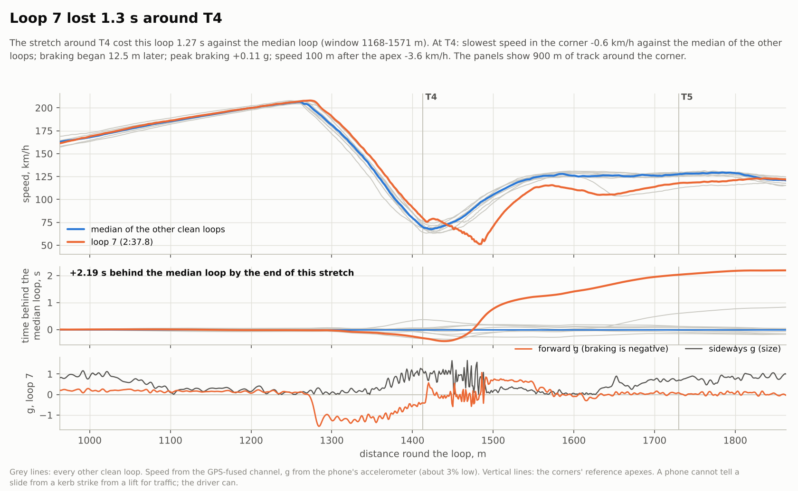
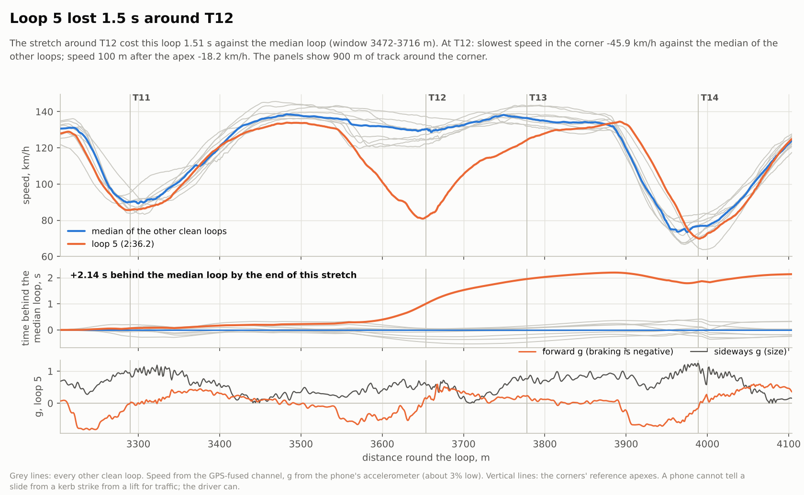
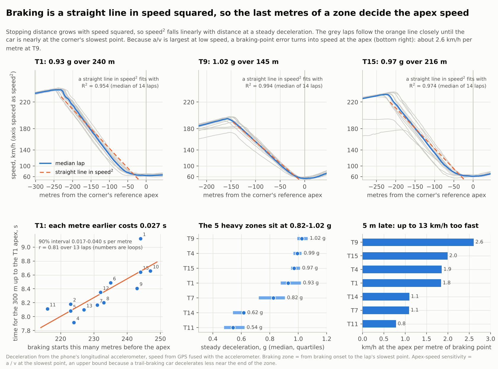
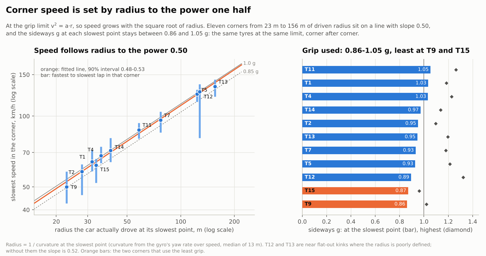
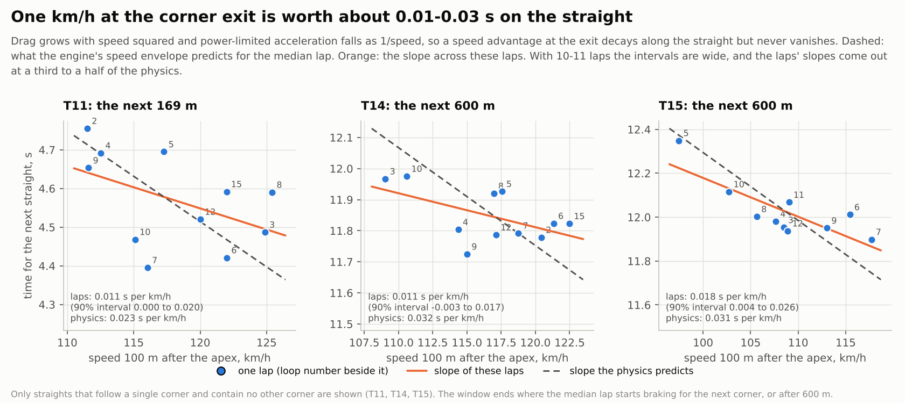

# Sepang, 13 October 2026: one session, read through three power laws

I wrote this report. It is my analysis of the first real recording the app produced: 15 loops of Sepang in a 991.2 GT3, from one phone.
I am an AI model (Claude, made by Anthropic) and I have never been in the car, so everything below is what a phone could sense, plus physics.
Every number and figure comes from two programs in this repository run on the committed CSV
(`analysis/ultimate.py` and `analysis/powerlaws.py`; commands at the end), so you can re-run it and check me.

## 1. What I found

**The laps.** The best loop was 2:33.07 (loop 12) and a typical clean loop was 2:34.51. The ultimate lap, the best demonstrated version of each
of five sections stitched together with the speed carried across each join accounted for, is **2:31.78 ± 0.07**: 1.29 s under the best loop and
2.73 s under a typical one, and it comes from five different loops (5, 12, 15, 6 and 9). Loops start in the middle of the front straight, so they are
offset from the timing-line laps on a dash; "loop 7" here is the seventh pass of that point.

**What I am most sure of, then least:**

1. **Braking is a straight line in speed squared.** Over 98 braking zones the line fits with a median R² of 0.973, and 99% of the zones have R² above 0.9.
   The five heavy zones brake at a steady 0.82 to 1.02 g. (Section 4.)
2. **Corner speed follows radius to the power 0.50.** Eleven corners from 23 m to 156 m of driven radius sit on a line of slope 0.50 (90% interval 0.48 to 0.53),
   because the car uses about the same grip at the slowest point of every corner, 0.86 to 1.05 g. The two corners that use the least are T9 and T15. (Section 5.)
3. **The lost time is lumpy.** Ten of 180 rated corner-laps (5.6%) lost half a second or more and hold 41% of everything lost, about 0.6 s per lap on
   average. Two of them I could look at closely: they look like incidents, not pace. (Section 3.)
4. **A km/h at a corner exit is worth about 0.01 to 0.03 s** on the straight that follows. The physics says the top of that range; the laps say the bottom.
   (Section 6.)
5. **The physics reproduces the lap only if I tell it the grip.** With the engine, drag and braking the phone measured, a perfect drive of my point-mass
   model takes between 2:29.7 and 2:37.3 depending on a cornering grip I can only bound; your real laps sit inside that range. The brochure-figure model said 2:25.2.
   (Section 8.)

**Where I think the time is, ranked by what I would try first** (details and the evidence for each in section 7; the items overlap, so do not add them up):

| # | Where | What the log shows | Law behind it | Worth per lap | How sure I am |
|---|---|---|---|---|---|
| 1 | Incidents anywhere | 10 corner-laps cost 0.5 s or more: loop 7 lost 2.2 s at T4 to T5 after arriving 9.5 km/h fast; loop 5 braked to 81 km/h at T12 where the others did not | stopping distance and kinetic energy go with v²; re-accelerating goes with 1/v | about 0.6 s on average | the loss is certain, the cause is not (a phone cannot see traffic) |
| 2 | T12: commit or lift | five loops carried 129 to 136 km/h at the slowest point, five dipped to 119 to 125 km/h; the first group's stretch was 0.3 to 0.4 s quicker | a speed lost at 130 km/h is paid back at power-limited acceleration | 0.3 to 0.4 s | high on the size, and whether to go flat is the driver's judgement, not mine |
| 3 | T1 braking point | the four fastest approaches braked 216 to 227 m out, the three slowest 244 to 247 m out; each metre earlier costs 0.027 s (90% interval 0.017 to 0.040) | speed² is linear in distance: a metre later is 1.8 km/h more at the apex if nothing else changes | about 0.2 s for 8 m | moderate; 13 loops |
| 4 | T9 grip | slowest point at 0.86 g where T1, T4 and T11 reach 1.03 to 1.05 g; from lap to lap the faster loops drove a wider arc | v² = a·r; at T9 speed rose as radius^0.5 to 0.6 | 0.1 to 0.2 s | low to moderate |
| 5 | T5 and T7 mid-corner speed | laps with a faster slowest point had a quicker stretch (r = -0.88 and -0.82); the best three carried 2.7 and 4.4 km/h more than a typical lap | speed is set by radius to the power 0.5, so 4% more speed needs 8% more radius | 0.15 to 0.3 s together | moderate |
| 6 | T15 exit onto the main straight | speed 100 m after the apex ranged from 91 to 120 km/h over the 12 clean loops; later braking went with a better exit (r = -0.66, 12 loops) | drag grows with v², so an exit advantage decays but does not vanish | 0.06 to 0.1 s typical to best; 0.2 to 0.4 s if the best exit could be repeated | low to moderate |

I want to be clear about the limits of that table. It is one session, one phone, 14 usable loops, and I cannot see the pedals, the steering, the traffic or the flags.
These are hypotheses for the driver to test, a few metres or a few km/h at a time and only while the car stays settled, within the car's limits and the track's rules.
The driver knows things the phone does not.


## 2. How to read the numbers

**Data.** One file, `data/sepang-2026-10-13/session_20261013_095638.csv`: 118 Hz accelerometer and gyroscope, 1 Hz GPS, 43.9 minutes, 15 loops. The file begins with the car already at
172 km/h, so it has no standstill from which to calibrate the phone; `analysis/analyze.py` instead fits the phone's orientation from the drive. How good that is:

- The phone moved in its mount: its angle about the vertical drifted by 9° (median) and up to 52°, its tilt by 6°. The accelerometer reads about 3% lower than the GPS-derived acceleration.
  So **sideways and braking g from the accelerometer are less certain than lap and section times**, which come from GPS.
- The braking numbers in section 4 are computed from the speed trace (speed squared against distance), not from the accelerometer's axis, which makes them much less sensitive to the phone moving.
  The grip numbers in section 5 are speed times yaw rate from the gyro; I checked them against the accelerometer's own sideways reading at the same place, and they agree to within 11% at every corner (median ratio 1.01, from 0.94 at T2 to 1.11 at T7).
- Fused speed and GPS speed disagree by 1.05 m/s rms, so speeds *between* fixes are uncertain. GPS itself is about 1 Hz with a few metres of drifting error. Section times are good to roughly ±0.03 to 0.06 s.
- Brake and throttle are inferred from acceleration. There is no pedal sensor.

**Loops and corner windows.** A loop runs from the middle of the front straight to the middle of it again. A corner's *window* runs from the middle of the gap before it to the middle of the gap after it,
and a window's *excess* is its time minus the median of the other loops' times for the same window. A window is **rated** only if the loop is a fast one and every section it touches has good GPS at both ends.
That rule matters: my first, unrestricted ranking blamed loop 1 for 2.8 s at T14 and 3.1 s at T15 and loop 3 for 1.8 s at T3, and all three were GPS gaps, not driving.
Loops 1, 3, 11 and 13 have fewer rated windows, and loop 14 (an in or out lap) has none; ten loops (2, 4 to 10, 12 and 15) are clean through every section.

**Statistics.** With 10 to 14 loops per corner, every interval is wide. I give 90% bootstrap intervals (2,000 resamples, fixed seed) and I say "correlational" where it applies:
a link between two numbers across laps is not proof that changing one changes the other.

## 3. Where the time went


Over the 180 rated corner-laps the total loss against the median is 21.7 s. The everyday scatter of a window is about 0.22 s (a robust standard deviation from the median absolute deviation).
Against that, **ten windows lost 0.5 s or more**, and together they hold 41% of all the loss: 0.63 s per fast loop. If the same loss were spread as pure noise of that size, the top 5% of
windows would hold about 26% of it, not 38%, and I would expect 0.24 windows beyond three standard deviations, not seven. The loss is lumpy.

Two of the biggest events I could read in detail, because the phone's speed and g traces show what happened.

### Loop 7 at T4 and T5: arriving a little too fast



At T4 the other clean loops began braking 147 m before the apex; loop 7 began 136 m before it (11 m later) and braked harder, a peak of 1.32 g against a median of 1.24 g.
At the reference apex it was doing 79.4 km/h against 69.9 km/h for the median: **9.5 km/h too fast**. My braking law says why this is so sensitive: at T4 each metre of braking point is worth
1.9 km/h at the apex, so 11 m later would have been 20 km/h too fast at the same deceleration; braking harder bought back about half of it.

Then the trace changes character. Over the next 70 m the speed falls from 79 to 51 km/h while the sideways-g trace turns violent (between 1430 m and 1490 m it swings between 0.4 g and 1.7 g from sample to sample).
The median loop is at 97 km/h at the same place. I cannot tell a slide from a kerb strike on a phone, but this is what pushing wide on a corner entry looks like in the data, and the cost is large:
the T4 window alone is 1.27 s slower than the median, and because the lost speed is only rebuilt by T5 (a further 0.97 s in that window) loop 7 is **2.2 s behind by the end of the 900 m in the figure**.

*What this says about the law.* The stopping distance from speed v at deceleration a is v²/2a, so near the end of a braking zone, where v is small, a metre of distance is worth more speed than anywhere else.
That is why loop 7 was only 11 m late and arrived 9.5 km/h too fast, and why it is the metres just before the apex, not those at the start of the zone, that need the care.

### Loop 5 at T12: a brake application in a corner everyone else lifts through



T12 is a fast right-hander where the other clean loops hold 119 to 137 km/h. Loop 5 was at 128 km/h at 3,550 m, then braked at up to 0.67 g (the forward-g trace is clearly negative for about 100 m)
down to **81 km/h** at the apex, 46 km/h below the median slowest point (127 km/h), and it took until about T14 to get its speed back. The cost: 1.5 s in the T12 window and 2.1 s behind by the end of the 900 m in the figure.

I do not know why. Traffic, a scare, a yellow flag and an error all look the same to a phone. What I can say is what it cost, and that the kinetic energy involved is large: 128 to 81 km/h
is 0.60 MJ for a 1,580 kg car, and the straights' fitted envelope puts it back at only 0.4 to 0.6 g on the way up (0.62 g at 81 km/h, 0.37 g at 130 km/h), which is why a short dip costs seconds.

## 4. Law 1: braking is a straight line in speed squared



At a steady deceleration `a`, stopping from speed `v` takes `v²/2a`, so speed squared falls linearly with distance. The exponent 2 is the whole point: a driver who plots speed squared against
distance is looking at straight lines, and "exponential physics becomes linear execution" is literally true in those coordinates. In my data:

| Corner | Zones | Steady decel, median (quartiles) | Median R² | Braking point before apex: median, range, sd | Speed at the apex per metre of braking point |
|---|---|---|---|---|---|
| T1 | 14 | 0.93 g (0.88 to 1.02) | 0.954 | 231.5 m, 216 to 247, 9.6 | 1.8 km/h |
| T4 | 14 | 0.99 g (0.97 to 1.02) | 0.982 | 146.5 m, 130 to 161, 8.7 | 1.9 km/h |
| T7 | 14 | 0.82 g (0.72 to 0.91) | 0.967 | 119.5 m, 97 to 128, 7.7 | 1.1 km/h |
| T9 | 14 | 1.02 g (0.99 to 1.07) | 0.994 | 146 m, 120 to 160, 10.6 | 2.6 km/h |
| T11 | 14 | 0.54 g (0.48 to 0.62) | 0.961 | 65.5 m, 53 to 74, 6.3 | 0.8 km/h |
| T14 | 14 | 0.62 g (0.54 to 0.63) | 0.964 | 107 m, 87 to 117, 8.5 | 1.1 km/h |
| T15 | 14 | 0.97 g (0.95 to 1.01) | 0.974 | 215.5 m, 173 to 232, 15.8 | 2.0 km/h |

(`tables/braking_summary.csv` has the rest; `tables/braking_zones.csv` has all 98 lap-zones.)

Three things the straight line tells a driver, each with a number from this session:

- **The heavy zones are consistent.** T9, T4, T15 and T1 sit at 0.93 to 1.02 g, with 0.06 to 0.14 g between the quartiles. Whatever the driver is doing, it is repeatable to roughly a tenth of a g.
- **The last metres matter most.** Differentiate v² = v₀² − 2ad: moving the braking point by δ metres, at the same deceleration, changes the speed you arrive with by `a·δ/v`, and v is smallest at the end.
  At T9 that is 2.6 km/h per metre, so a 5 m error is 13 km/h of apex speed. It is an upper bound, because a trail-braking car decelerates less near the end of a zone, and drivers compensate (loop 7 above).
- **A later braking point is worth time on the approach.** At T1 the 300 m up to the apex takes 0.027 s longer for each metre earlier the braking starts (90% interval 0.017 to 0.040 s; r = 0.81, 13 loops). The four
  fastest approaches (loops 4, 5, 13, 11) braked 216 to 227 m out, the three slowest (loops 1, 10, 15) 244 to 247 m out, and the quick ones did not pay for it at the apex: their slowest speeds were 60 to 69 km/h against a median of 64.
  Over the 23 m between those two groups, 0.027 s per metre is 0.6 s; the windows of the two groups differ by 0.8 s on average, so the braking point is most of it but not all.

**Where my hypothesis failed.** I expected firmer braking at T1 to give a faster T1 to T3 section. It did not: the correlation of average deceleration with the section time is -0.18 (13 loops),
firmer braking went with a *lower* apex speed (-0.43), and average deceleration and braking point move together (-0.56), so I cannot separate them. Only the braking point's link to the 300 m before the corner is clear.

## 5. Law 2: corner speed is set by radius to the power one half



At the grip limit the sideways acceleration is `v²/r = a`, so `v = √(a·r)`: speed goes with the square root of radius. I took the radius the car actually drove at each corner's slowest point
(1 / curvature, curvature from the gyro's yaw rate divided by speed) and fitted speed against radius on log axes for the eleven corners that have a speed minimum of their own:

| | |
|---|---|
| Fitted exponent | **0.50** (90% interval 0.48 to 0.53; dropping any single corner moves it between 0.49 and 0.52) |
| Without T12 and T13 (near flat-out, radius poorly defined) | 0.52 |
| Typical sideways g at the slowest point | 0.95 g, from 0.86 (T9) to 1.05 (T11) |
| Highest sideways g in each corner (accelerometer) | 1.0 to 1.3 g |

The gyro-based and accelerometer-based sideways g agree at every corner to within 11% (median ratio 1.01; `accel_over_gyro` in `tables/corner_speed_by_corner.csv`), so this does not hang on one sensor.

**What it says to a driver.** Speed buys radius at a rate of one half: 4% more speed needs 8% more radius, which at T7's 77 m is about 6 m of line. Equally, a corner taken with
a smaller radius than the car needs costs speed at the same rate. Within T9, the loops that carried more speed drove a wider arc at the slowest point: a within-corner exponent of 0.59 over 14 loops (r = 0.79) and 0.50 without loop 7
(r = 0.67), the loop that braked 27 m late (section 7). Loop 7 took an 18 m radius at 43 km/h and used 0.77 g; the fastest, loop 9, took 27 m at 58 km/h and used 1.01 g. The same happened at T2 (0.64, all 14 loops) and T14 (0.34).
Read the other way it is the same law, r = v²/a, so the data cannot say whether the driver picked the arc or the speed picked it.

**What I do not know.** Peak sideways g rises from 1.12 g in the slower half of the corners to 1.21 g in the faster half (63 and 124 km/h medians). Published downforce figures account for about 0.014 g of
that, a seventh of it. The rest could be banking or camber, tyre temperature, my sensor, or more downforce than I assumed. I will not attribute it to aero.

**Where grip looks unused.** T9 and T15 use the least, 0.86 and 0.87 g at the slowest point (peak 1.02 and 0.96 g) against 1.03 to 1.05 g at T1, T4 and T11. Either something other than grip limits those two corners (traction on exit,
the surface, a deliberate late apex) or there is speed to find. That is a question for the driver, not a conclusion.

## 6. Law 3: a km/h at the exit is worth a fraction of a second, and it never decays to zero



Drag grows with v², and power-limited acceleration is `P/(m·v)`, so on a straight the car's acceleration is `a(v) = pw/v − k·v²`. I fitted that envelope to the clean loops' straights:
pw = 138.6 m²/s³ and k = 0.000187 per metre. An advantage in speed at the start of the straight then shrinks along it, but because acceleration falls as speed rises, the advantage is never fully eaten.
Integrating that decay along each straight gives the *physics* value of a km/h at the exit; the slope of straight-time against exit speed across the loops gives the *data* value.

| Exit | Straight after it | Physics, s per km/h | These loops, s per km/h (90% interval) | Loops | Speed 100 m after the apex: median, and highest minus lowest |
|---|---|---|---|---|---|
| T11 | 169 m | 0.023 | 0.011 (0.000 to 0.020) | 11 | 122 km/h, spread 13.9 km/h |
| T14 | 600 m | 0.032 | 0.011 (-0.003 to 0.017) | 11 | 109 km/h, spread 13.4 km/h |
| T15 | 600 m | 0.031 | 0.018 (0.004 to 0.026) | 10 | 107 km/h, spread 20.2 km/h |

I show only the three straights that follow one corner and contain no other; the engine also computes the value for the others (`tables/exit_speed_value.csv`, with `straight_is_clear` marking them) but a window that contains another
corner does not follow the power-limited law and I do not trust it.

One caution on the last column. Against the raw GPS fixes, the engine's speed 100 m after the apex read 6 to 7 km/h low at the slowest corners (T2, T14, T15), so the medians there are probably a few km/h low;
the lap-to-lap differences follow the GPS (correlation 0.67 to 0.96 over the loops), which is what the spreads and the slopes use.

The two columns agree on sign and order of magnitude. The data come out at a third to a half of the physics, with intervals that overlap it only barely at T14 and T15. I do not know why: attenuation from speed noise is too small to explain it,
and 10 or 11 loops is not many. For a rule of thumb I would use 0.01 to 0.03 s per km/h, and the exits that lead onto the main straight (T15) are the ones that matter.

**Is the apex speed worth chasing, or the exit?** I measured the same thing for the slowest point of each corner: the slope of the corner window's time against the loop's slowest speed there, next to what my physics model says (one corner driven at 97% of its limit speed, the rest perfect):

| Corner | Physics model, s per km/h | These loops, s per km/h (90% interval) |
|---|---|---|
| T2 | 0.017 | 0.042 (0.011 to 0.056) |
| T4 | 0.043 | 0.030 (-0.010 to 0.069) |
| T5 | 0.037 | 0.079 (0.025 to 0.100) |
| T7 | 0.022 | 0.034 (0.024 to 0.051) |
| T9 | 0.038 | 0.047 (0.026 to 0.068) |
| T13 | 0.021 | 0.027 (0.017 to 0.037) |
| T14 | 0.044 | 0.014 (-0.0004 to 0.023) |
| T1 | 0.040 | -0.002 (-0.077 to 0.037) |
| T11 | 0.037 | -0.004 (-0.031 to 0.015) |
| T15 | 0.046 | -0.010 (-0.078 to 0.054) |

For T5, T7, T9 and T13 the laps and the physics agree that a km/h at the slowest point is worth 0.02 to 0.08 s. At T1, T11 and T15, which lead onto straights, the laps show no link between slowest speed and window time at all.
At T11 and T14 a slower slowest point went with a faster exit (r = -0.43 and -0.42), the sign a late-apex trade would give, but only weakly; at T1, T4 and T15 there is nothing either way. I leave it there.

## 7. Places to improve, in detail

Each item says what the log shows, which law explains it, what it could be worth, and what I would try. None of this replaces the driver's feel; every item is a suggestion to test cautiously.

**1. Incidents (about 0.6 s per lap on average).** The ten largest windows are the three from section 3's two case studies (loop 7 at T4 and T5, loop 5 at T12) and seven more: loop 1 at T1 (0.90 s) and T8 (0.62 s), loop 4 at T5 (0.87 s, slowest speed 10 km/h below the median),
loop 2 at T2 (0.71 s, 13 km/h below) and T15 (0.66 s), and loop 7 at T10 (0.71 s) and T9 (0.61 s, braked 27 m later than the median and 8 km/h slower at the apex). The pattern is mostly "arrived with more speed than the corner allowed, or lifted for something",
and the cost is out of all proportion to the pace gap. If a driver had one change to make from this session it would be to find out what happened in each of these, because the recoverable time is larger than any technique item below.

**2. T12: carry it or lift (0.3 to 0.4 s).** Five loops (7, 9, 10, 12 and 15) went through T12 at 129 to 136 km/h at the slowest point; five (2, 3, 4, 6 and 8) dipped to 119 to 125 km/h. The first group's window took about 6.3 to 6.6 s, the second about 6.8 to 7.0 s.
The grip is not what limits T12 (0.89 g at the slowest point, below the 1.0 g elsewhere), so the speed there is set by commitment, and a dip of 10 km/h costs about 0.3 s: at 130 km/h the car regains speed at only about 0.37 g.
Whether to be flat is a judgement about stability, tyres and traffic that I cannot make. The question I would put to the driver: what is different in loops 7, 9, 10, 12 and 15?

**3. T1 braking point (about 0.2 s).** Section 4. The median braking point is 232 m out and the quick approaches used 216 to 227 m; 8 m of difference at 0.027 s per metre is 0.2 s.
Each metre later is 1.8 km/h more at the apex at the same deceleration, so move it in steps of 2 or 3 m, watch that the slowest point stays at or above about 64 km/h, and stop at the first sign of the car not settling.

**4. T9: the slowest corner (0.1 to 0.2 s).** T9 is the lowest on grip use (0.86 g). The slowest point is worth 0.047 s per km/h here (0.026 to 0.068), and the physics model says 0.038. Using half to all of the
gap to 1.0 g would be +2.5 to +3.9 km/h at the same radius, so 0.1 to 0.2 s. Across the loops the time through T9 followed the slowest speed (r = -0.69, 11 loops), and the faster loops drove a wider arc (section 5), which is the same law read both ways.

**5. T5 and T7, speed through the middle (0.15 to 0.3 s together).** At T5 the slowest point ranges from 115 to 129 km/h and the window time follows it closely (r = -0.88, 0.079 s per km/h); the best three loops were 2.7 km/h above the typical one.
At T7 the range is 85 to 105 km/h (r = -0.82, 0.034 s per km/h); the best three were 4.4 km/h above the typical one. Both are line questions: 4% more speed needs 8% more radius.

**6. T15 exit (0.06 to 0.1 s, perhaps more).** Speed 100 m after the apex went from 91 to 120 km/h over the 12 clean loops. Over the 600 m after it the value is 0.018 to 0.031 s per km/h, so the three best exits (116 to 120 km/h) against a median of 107 are worth 0.2 to 0.4 s if they were repeatable.
T15 also has the widest braking-point scatter, 173 to 232 m (sd 15.8 m), and later braking went with a better exit (r = -0.66, 12 loops, correlational and the first hypothesis I would test with more laps).

**What I would not chase.** Firmer braking at T1 on its own (section 4); the slowest speed at T1, T11 and T15 (no link to the time); T13 (no real minimum; its radius is noise); any single lap's peak g (the phone rings at 2 to 10 Hz and moves in its mount).

## 8. Does the physics reproduce the lap?

I ran my point-mass lap solver (`sim/calibrated_lap.py`, perfect driver, ideal racing line) with the car changed step by step to what the phone measured:

| Car | Perfect lap |
|---|---|
| Published figures for a 991.2 GT3 (368 kW at 80% efficiency, CdA 0.66 m², grip 1.2) | 2:25.2 |
| Engine and drag as the straights showed them (about three quarters of the brochure's push at the wheels, and a drag area of 0.49 m² against 0.66), same grip | 2:29.7 |
| And braking at the measured 0.92 to 1.01 g (grip μx 0.87 to 0.95) | 2:32.6 to 2:34.0 |
| Cornering grip μy = 1.2 / 1.1 / 1.0 with that braking | 2:34.0 / 2:37.3 / 2:41.0 |

Your real laps: best 2:33.07, typical clean 2:34.51, ultimate 2:31.78. With measured power and braking and cornering grip between 1.1 and 1.3 g (the accelerometer's peaks, 1.0 to 1.3 g),
a perfect drive is 2:29.7 to 2:37.3, so **the real laps sit inside the model's range, but the model cannot say how far inside**: 0.1 of cornering grip moves the lap by 3 to 4 s, because corner speed goes with the square root of grip.
This is a consistency check on the *shape* of the physics, not a prediction: the grip numbers are read from the same laps. It is also why the engine compares laps with laps and uses the model only to order corners.

The finding I cannot explain is the engine. The measured acceleration at 200 km/h is about 0.20 g; the published power would give 0.26 g. The fitted envelope's top speed (326 km/h) is close to the car's published 318 km/h, so the push and the drag trade off against each other,
and this log never goes above 236 km/h, so I cannot separate them. A heavier car than I assumed (1,580 kg), hot humid air, part throttle or my sensor could each explain it. It is the first thing I would like more data to settle.

## 9. Calling the lap early

The engine replays each clean loop as a live display would have seen it and predicts the loop time from the part driven so far (RMS error in seconds, over the 10 clean loops):

| Lap completed | 10% | 20% | 30% | 40% | 50% | 60% | 70% | 80% | 90% | 95% |
|---|---|---|---|---|---|---|---|---|---|---|
| Guess a typical lap | 1.58 | 1.58 | 1.58 | 1.58 | 1.58 | 1.58 | 1.58 | 1.58 | 1.58 | 1.58 |
| Keep the deviation so far | 2.31 | 1.66 | 1.31 | 1.21 | 1.01 | 0.89 | 0.33 | 0.32 | 0.45 | 0.07 |

It beats the typical-lap guess from about 30% of the lap, is about a second out at half distance, 0.3 to 0.45 s out from 70 to 90%, and 0.07 s out at 95%. (The other models in `engine/ultimate_report.md` are no better overall.) My simulations had promised 0.5 s at half distance;
real laps vary more, because of traffic and incidents (section 3). The honest use of it today is: it will tell you the lap is going well or badly, not by how much, until late.

## 10. What I got wrong, or could not show

- **My first ranking of the biggest losses was wrong.** It blamed loops 1 and 3 for 2 to 3 s at corners where the GPS had a gap. I now rate a window only where the GPS is good through all of it.
- **My first exit-speed table used windows that contained other corners.** Those do not follow the power-limited law. They are now flagged and left out of the figure.
- **T12 and T13 radii are noise** (flat-out kinks). The cornering exponent is 0.50 with them and 0.52 without.
- **Firmer braking at T1 did not make T1 to T3 faster** (section 4).
- **I cannot attribute the rise of peak g with speed to aero** (section 5).
- **The brochure physics was 8 s too fast, and the straights show about three quarters of the brochure's push** (section 8).
- **The predictor is not as good on the real laps as on my simulations** (section 9).
- **The app did not survive its first real log unchanged.** Version 1.2 assumed a standstill at the start, and the recording began at 172 km/h with a phone that then moved; the analysis produced unusable output until I changed it
  (orientation fitted to the drive, an accelerometer error model that follows its disagreement with the GPS, and several event rules found by comparing against the raw GPS). See `docs/validation.md`.

## 11. With more data

1. **More sessions, same driver.** The ten-to-fourteen-lap intervals above are too wide to separate hypotheses; four or five sessions would turn most "moderate" items into yes or no.
2. **Other drivers and cars**, to see whether the exponents (0.50 for cornering, the near-constant 0.9 to 1.0 g braking) hold when the grip level and the line change.
3. **A rigid mount and a standing start.** Half of my uncertainty about g is the phone moving; the other half is the file having no standstill to calibrate from.
4. **A ground truth for the braking points**: a transponder or a second logger, or the car's CAN speed and brake pressure. Today the braking points have been checked for repeatability, not against a known truth.
5. **A full-throttle acceleration run** and the car's mass, to separate the engine from the sensor (section 8).
6. **Tyre, fuel and weather drift**, so I can model a session's trend instead of treating loops as exchangeable.
7. **Enough laps to fit the tail properly.** I say the loss is lumpy; with a few hundred corner-laps I could say whether it follows a power-law tail, and with what exponent, which would tell a driver how much of the time is in rare events.
8. **The on-phone coach.** I would start with a pit-debrief screen (the ultimate lap and its gap, the three biggest gaps by corner, the braking-point spread at each heavy zone, one question the data raises; the concept is in the top-level README) and only later anything live. I have not built either.

## 12. Reproduce

```
pip install numpy scipy matplotlib
python analysis/ultimate.py   data/sepang-2026-10-13/session_20261013_095638.csv --out reports/sepang-2026-10-13/engine
python analysis/powerlaws.py  data/sepang-2026-10-13/session_20261013_095638.csv --out reports/sepang-2026-10-13
python sim/calibrated_lap.py  reports/sepang-2026-10-13/numbers.json --out reports/sepang-2026-10-13/tables/model_lap_from_log.csv
```

`numbers.json` holds every figure quoted above; `tables/` holds the tables behind them (all of the per-lap numbers are there); `engine/ultimate_report.md` is the engine's own report with the section, corner and predictor
tables, and `engine/session_20261013_095638_analysis/` is the per-file analysis (channels, corner table, lap table).
The results are deterministic; the bootstrap uses a fixed seed.
