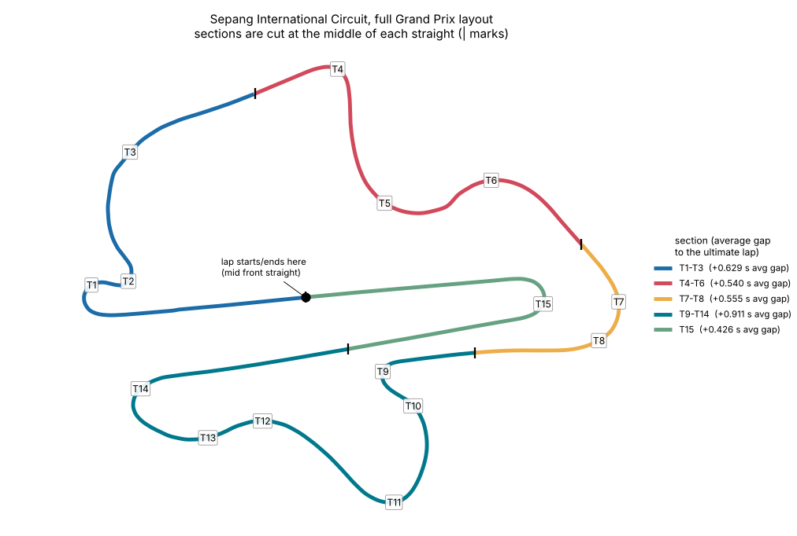
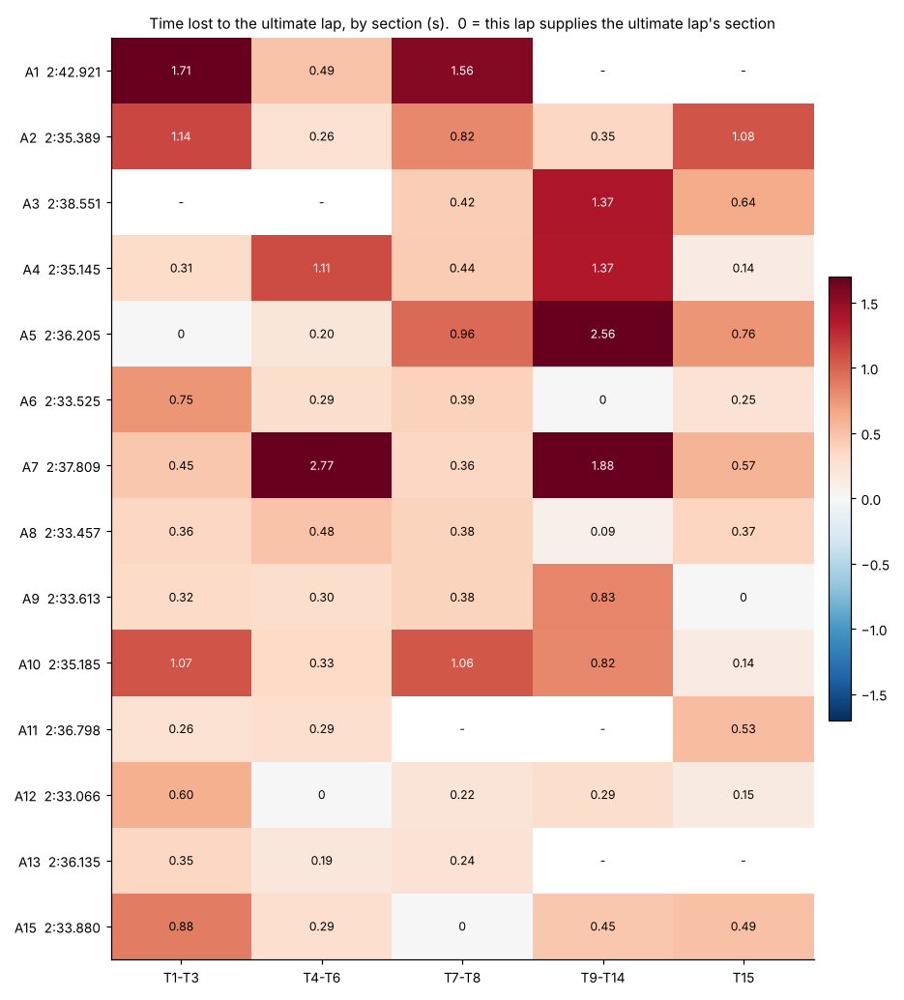
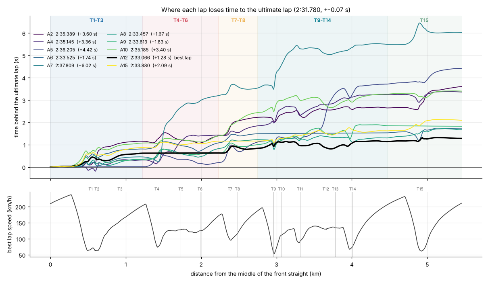
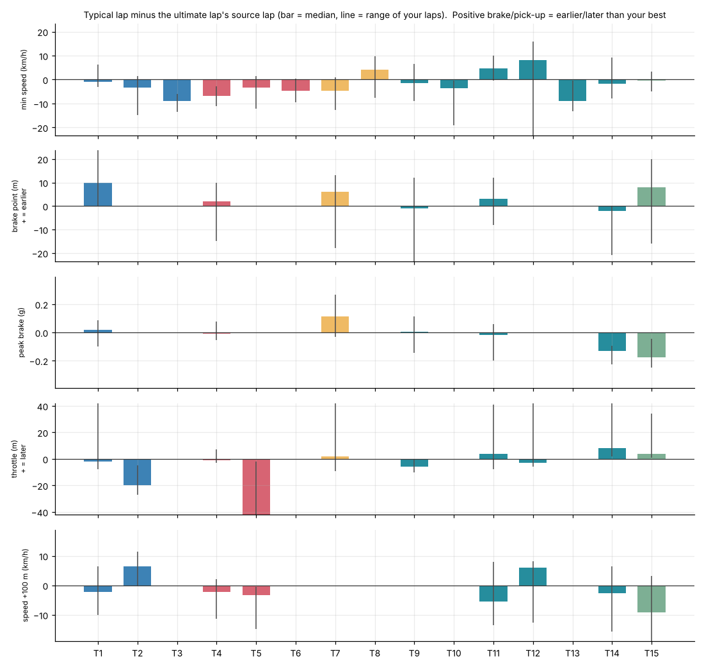
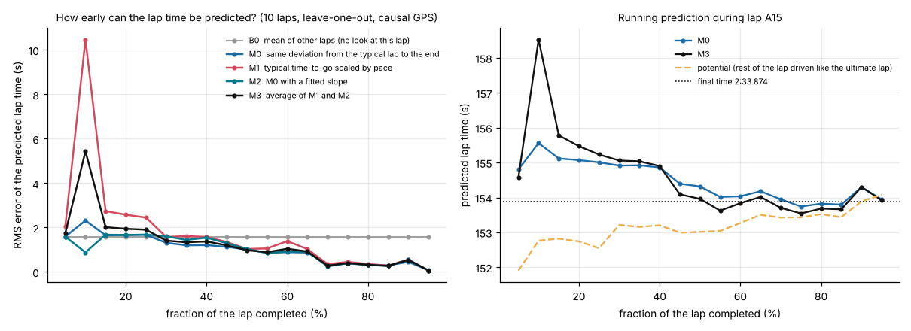

# Ultimate lap report

Sepang International Circuit, full Grand Prix layout - 1 file(s), 15 complete loops (14 fast, 10 clean through every section). Generated 2026-10-13 07:57.

## 1. Summary

| | |
|---|---|
| Your fastest loop | **2:33.066** (A12) |
| Ultimate lap (best demonstrated section of each kind, noise-corrected) | **2:31.780** +-0.07 s |
| ... before the noise correction | 2:31.769 |
| Gain over your fastest loop | 1.29 s |
| Typical clean loop | 2:34.512 (2.73 s slower than the ultimate lap) |
| GPS quality (sideways scatter of fixes on the straights) | 1.3 m - good |
| Physics reference (a simple point-mass model on a perfect line, grip mu 1.1 / 1.2 / 1.3) | 2:26.237 / 2:21.769 / 2:17.980 - a rough, unvalidated ceiling; real cars are usually slower, so it is not a target |

**Where the time is, on average over the loops that have a good fix in each section (gap to the ultimate lap):** T9-T14 0.91 s, T1-T3 0.63 s, T7-T8 0.56 s, T4-T6 0.54 s.

**What differs most between a typical loop and the ultimate lap's source laps:**

- T13: 8.9 km/h slower through the slowest point
- T15: 9.3 km/h slower 100 m after the apex
- T4: 6.9 km/h slower through the slowest point
- T7: 4.7 km/h slower through the slowest point
- T11: 5.5 km/h slower 100 m after the apex
- T15: peak braking 0.17 g lower

## 2. The ultimate lap, section by section

A section runs from the middle of one straight to the middle of the next. The time of a section is corrected for the speed the lap carried over the cut (a lap that leaves a corner faster starts the next section faster; the correction is the *price* in the table, seconds per m/s). The ultimate lap is the sum of the best corrected sections.

| Section | Corners | Source lap | Value (s) | Typical loop (s) | Gain vs typical (s) | Price (s per m/s) | Spread of your laps (s) |
|---|---|---|---|---|---|---|---|
| 1 | T1-T3 | A5 | 35.929 | 36.382 | 0.453 | 0.059 | 0.47 |
| 2 | T4-T6 | A12 | 29.294 | 29.588 | 0.293 | 0.012 | 0.72 |
| 3 | T7-T8 | A15 | 13.277 | 13.671 | 0.394 | 0.016 | 0.43 |
| 4 | T9-T14 | A6 | 49.174 | 49.991 | 0.817 | 0.022 | 0.81 |
| 5 | T15 | A9 | 24.106 | 24.538 | 0.431 | 0.055 | 0.31 |
| | | | **151.780** | **154.169** | **2.389** | | |

## 3. Every loop against the ultimate lap

| Loop | Time | Gap | T1-T3 | T4-T6 | T7-T8 | T9-T14 | T15 | Note |
|---|---|---|---|---|---|---|---|---|
| A1 | 2:42.921 | - | +1.709 | +0.491 | +1.557 | - | - | not clean through every section |
| A2 | 2:35.389 | +3.647 | +1.139 | +0.256 | +0.822 | +0.354 | +1.075 |  |
| A3 | 2:38.551 | - | - | - | +0.420 | +1.370 | +0.637 | not clean through every section |
| A4 | 2:35.145 | +3.368 | +0.308 | +1.115 | +0.438 | +1.368 | +0.140 |  |
| A5 | 2:36.205 | +4.475 | -0.002 | +0.203 | +0.958 | +2.559 | +0.758 |  |
| A6 | 2:33.525 | +1.683 | +0.747 | +0.293 | +0.394 | -0.001 | +0.250 |  |
| A7 | 2:37.809 | +6.037 | +0.453 | +2.770 | +0.357 | +1.883 | +0.574 |  |
| A8 | 2:33.457 | +1.676 | +0.356 | +0.484 | +0.380 | +0.088 | +0.368 |  |
| A9 | 2:33.613 | +1.833 | +0.321 | +0.303 | +0.380 | +0.834 | -0.005 |  |
| A10 | 2:35.185 | +3.417 | +1.070 | +0.334 | +1.057 | +0.817 | +0.138 |  |
| A11 | 2:36.798 | - | +0.256 | +0.291 | - | - | +0.525 | not clean through every section |
| A12 | 2:33.066 | +1.264 | +0.602 | -0.001 | +0.217 | +0.294 | +0.151 |  |
| A13 | 2:36.135 | - | +0.347 | +0.188 | +0.241 | - | - | not clean through every section |
| A14 | 2:46.779 | - | - | - | - | - | - | in/out/slow loop - not used |
| A15 | 2:33.880 | +2.112 | +0.877 | +0.291 | -0.003 | +0.453 | +0.495 |  |

(Loops start and end in the middle of the front straight, so they are offset from the timing-line laps you see on a dash.)

## 4. Driver inputs, corner by corner

Values of the loop that supplies the ultimate lap's section (the *source*), and how a typical loop differs. *Braking from* is how far before the corner's reference apex the main braking zone starts (deceleration first beyond 0.30 g, or beyond 35 % of that zone's peak if that is more; the reference apex is the map's apex, moved to where your own laps run slowest when that is more than 8 m away), so it is a position on the track you can compare lap to lap; peak brake is the strongest 0.2 s of braking, not the best instant (a phone in its mount rings at 2-10 Hz, which moves a single instant by 0.1-0.2 g from lap to lap); pick-up is how far after the slowest point forward acceleration first exceeds 0.10 g (blank if that does not happen before the next corner's braking zone starts); speed +100 m is left blank where the next corner is closer than 100 m or its braking zone starts within 25 m of that point (it would then measure how early each lap braked for the next corner). A lift that sheds under 15 km/h is not counted as a braking zone. Corners that never reach a speed minimum of their own (linked) show only cornering and speed. Braking points are the least certain numbers here: a phone senses braking only through acceleration, and lifting off at high speed already slows a car. Use them to check repeatability, and move a braking point later only a few metres at a time and only while the car stays settled.

| Corner | Src | Min speed | Braking from | Peak brake | Pick-up | Speed +100 m | Peak lat | Typical vs source |
|---|---|---|---|---|---|---|---|---|
| T1 | A5 | 65 km/h | 223 m | 1.35 g | 8 m* | 63 km/h | 1.28 g | braked 10 m earlier |
| T2 | A5 | 61 km/h | - | - | 29 m | 101 km/h | 1.17 g | 3.2 km/h slower through the slowest point; throttle 20 m earlier after the apex; 6.4 km/h faster 100 m after the apex |
| T3 (linked) | A5 | 165 km/h | - | - | - | - | 1.30 g | - (no speed minimum of its own) |
| T4 | A12 | 74 km/h | 145 m | 1.25 g | 3 m | 118 km/h | 1.26 g | 6.9 km/h slower through the slowest point |
| T5 | A12 | 127 km/h | - | - | 72 m* | 130 km/h | 1.30 g | 3.4 km/h slower through the slowest point; 3.4 km/h slower 100 m after the apex |
| T6 (linked) | A12 | 125 km/h | - | - | - | - | 1.36 g | - (no speed minimum of its own) |
| T7 | A15 | 100 km/h | 115 m | 0.99 g | 10 m* | - | 1.27 g | 4.7 km/h slower through the slowest point; peak braking 0.11 g higher |
| T8 (linked) | A15 | 111 km/h | - | - | - | - | 1.27 g | - (no speed minimum of its own) |
| T9 | A6 | 52 km/h | 148 m | 1.22 g | 10 m | - | 0.92 g | throttle 6 m earlier after the apex |
| T10 (linked) | A6 | 113 km/h | - | - | - | - | 1.32 g | - (no speed minimum of its own) |
| T11 | A6 | 84 km/h | 62 m | 0.81 g | 9 m* | 123 km/h | 1.23 g | 4.8 km/h faster through the slowest point; 5.5 km/h slower 100 m after the apex |
| T12 | A6 | 121 km/h | - | - | 6 m | 130 km/h | 1.26 g | 8.0 km/h faster through the slowest point; 6.0 km/h faster 100 m after the apex |
| T13 | A6 | 143 km/h | - | - | - | - | 1.38 g | 8.9 km/h slower through the slowest point |
| T14 | A6 | 72 km/h | 108 m | 0.93 g | 2 m | 112 km/h | 1.15 g | peak braking 0.13 g lower; throttle 8 m later after the apex; 2.6 km/h slower 100 m after the apex |
| T15 | A9 | 63 km/h | 211 m | 1.46 g | 0 m | 116 km/h | 0.97 g | peak braking 0.17 g lower; 9.3 km/h slower 100 m after the apex |

\* The throttle pick-up at this corner varies by more than 25 m from lap to lap (the 0.10 g threshold is crossed at light throttle, so a small change in throttle moves it a long way): the value is shown, but no comparison is made.

### Latest clean loop (A15, 2:33.880): differences against the ultimate lap's source laps

- T13: 8.9 km/h slower through the slowest point
- T15: 9.8 km/h slower 100 m after the apex
- T15: throttle 21 m later after the apex
- T4: 6.8 km/h slower through the slowest point
- T15: peak braking 0.21 g lower
- T15: 4.9 km/h slower through the slowest point
- T5: 5.8 km/h slower 100 m after the apex
- T1: braked 21 m earlier

## 5. Predicting the lap while it is being driven

Each clean loop was replayed the way a live display would have seen it: GPS fixes arrive late and only the part of the lap driven so far is used. The typical lap it is compared with is built from all the *other* loops, including later ones, which a live display would not have yet (a small advantage in the simulated tests). RMS error of the predicted loop time (s):

| Lap completed | 10% | 20% | 30% | 40% | 50% | 60% | 70% | 80% | 90% | 95% |
|---|---|---|---|---|---|---|---|---|---|---|
| B0 no look at the lap | 1.58 | 1.58 | 1.58 | 1.58 | 1.58 | 1.58 | 1.58 | 1.58 | 1.58 | 1.58 |
| M0 deviation stays | 2.31 | 1.66 | 1.31 | 1.21 | 1.01 | 0.89 | 0.33 | 0.32 | 0.45 | 0.07 |
| M1 pace-scaled | 10.47 | 2.58 | 1.57 | 1.58 | 1.03 | 1.38 | 0.35 | 0.36 | 0.56 | 0.06 |
| M2 fitted slope | 0.88 | 1.66 | 1.60 | 1.54 | 1.03 | 0.92 | 0.25 | 0.31 | 0.55 | 0.06 |
| M3 average of M1, M2 | 5.43 | 1.94 | 1.41 | 1.37 | 0.98 | 1.04 | 0.28 | 0.32 | 0.54 | 0.06 |

Reading it: the prediction beats "no look" only once the error falls clearly below the B0 row. On simulated laps the best model was within about half a second from half-way, about a quarter of a second in the last quarter and a tenth only in the last 5 %; earlier it mostly tells you the lap is going well or badly.

## 6. How far to trust this

**About this recording** (found by the per-file analysis; see its report.md):

- session_20261013_095638: No standstill in this file (the recording began on the move, or the car never stopped), so the phone's mounting angle was fitted to the drive itself: the accelerometer against the GPS speed change and the GPS course change, over a sliding window of about a minute (2626 GPS intervals, residual 2.2 m/s2, GPS time lag 0.39 s).
- session_20261013_095638: WARNING: the phone did not stay put. Its angle about the vertical drifted by 9 degrees (median) and up to 52 degrees from its average, and its tilt by 6 degrees. Braking and cornering numbers from the accelerometer are less certain than usual; GPS speeds and lap times are not affected much.
- session_20261013_095638: The accelerometer reads 3 % lower than the GPS-derived accelerations (a mount that flexes does this).
- session_20261013_095638: Speed fusion: accelerometer bias -0.00 m/s2 (median), 32 GPS fixes skipped as outliers, 5 resets to GPS; fused speed agrees with the GPS fixes to 1.05 m/s rms (the accelerometer's error model was widened 7-fold: it does not follow the car as closely as a rigidly mounted, calibrated phone would)
- session_20261013_095638: WARNING: the fused speed and the GPS disagree by more than 1 m/s rms; speeds between GPS fixes are uncertain.

- Times come from a phone: GPS about 1 Hz with 2-3 m of slowly drifting error, plus motion sensors. Each section time is good to roughly +-0.03-0.06 s (more when the GPS scatter above is high); the ultimate lap's own error bar is printed above and is widened automatically when the GPS is noisy.
- The ultimate lap is the best you have *shown, in pieces*. Joining pieces assumes each can be repeated together; the speed correction handles the hand-over between corners to first order only.
- Brake and throttle are *inferred* from acceleration; there is no pedal sensor. Compare the same corner across laps, not different corners.
- The measurements, the stitching and the lap-time predictor were validated on simulated Sepang sessions with known answers (see the README). Their accuracy on real phone data is not yet established: expect to see different noise levels.
- Do not mix wet and dry runs, or very different tyre/fuel states, in one analysis unless you want them compared.
- Use the gaps to become more consistent first. Every piece of the ultimate lap is something you have already done, so the way to close a gap is repeating your best, not pushing past what you can do safely. Stay within your own limits, the car's and the organiser's rules, and never look at the phone while driving.

